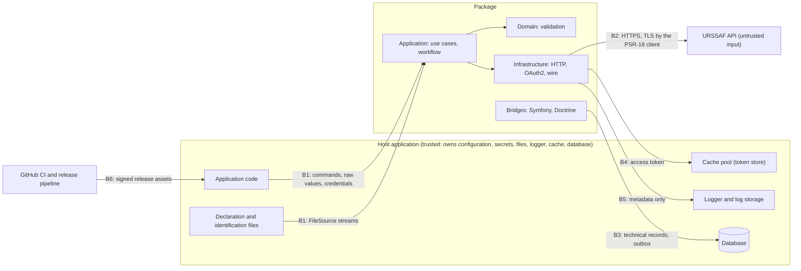

# Security assurance case

This document argues why the security requirements of `thebeardedbear/urssaf-plateforme-numerique` are met. It is
grounded in a review of the code at the commit named in the [security review](security-review-2026-11.md): each claim
points to the file that implements it, and the document states its limits. The package is a library, so part of the
security of a deployment belongs to the host application (see [Assumptions on the host](#7-assumptions-on-the-host-application)).

Reporting a vulnerability: [SECURITY.md](../../SECURITY.md).

## 1. What is protected

The package lets a digital platform send identification files and declaration / regularisation files of its
auto-entrepreneurs to the URSSAF "API portail Plateforme numérique" (*Échanges réels* and the *Bac à sable* test API),
follow their processing and payment status, download the report files and read the notification feed. It authenticates
with OAuth2 client credentials.

| Asset | Where it lives | Sensitivity |
|---|---|---|
| OAuth2 `client_id` / `client_secret` of each tenant | Host configuration or `CredentialsProvider`; in memory in `Application\Port\Credentials` | Secret |
| Access token | `TokenStore` (PSR-6 / PSR-16 cache pool), in memory during a call | Secret, short lived |
| Identification and declaration files (XML, compressed) | Host storage, read through `FileSource`, streamed to URSSAF | Personal data of the platform's auto-entrepreneurs, social contributions, integrity critical |
| Report files downloaded from URSSAF | Streamed to a file chosen by the operator, never stored by the package | Personal data, integrity critical |
| Submission records: tenant, platform id, external reference, file name, SHA-256 fingerprint, state, `urssafRef`, status and payment status, URSSAF error codes and messages | `Domain\Submission\*`, host database (Doctrine mapping, tables `urssaf_pn_*`) | Technical data, no personal field ([ADR 0009](../adr/0009-personal-data.md)) |
| Uploader `userId` and `userEmail` | Live read models only, masked in dumps | Personal data (GDPR), never persisted nor logged |
| Integration events (outbox) | `urssaf_pn_outbox` table or in memory | Technical identifiers and raw status codes only, no personal data |
| Source code and releases | GitHub repository, Packagist, release assets | Integrity critical (supply chain) |

## 2. Security requirements

| ID | Requirement |
|---|---|
| SR1 | Credentials and tokens are never persisted by the package, never logged, never present in exception messages, and masked when dumped. |
| SR2 | Personal data (uploader `userId` / `userEmail`, the content of files and reports) is never persisted by the package, never logged, never present in exception messages nor in integration events. |
| SR3 | The file sent to URSSAF is the file the host asked for (name validated, content streamed unchanged), and an upload is never resent automatically: a lost answer is reconciled, not blindly repeated. |
| SR4 | Everything received from URSSAF is untrusted: parsed strictly, never executed or deserialised into arbitrary objects, a malformed response fails closed, and values taken from a response and used in a later request are encoded. |
| SR5 | Requests are authenticated and sent to the intended URSSAF host; one tenant can neither use nor see another tenant's credentials, tokens or submissions. |
| SR6 | A failure of URSSAF or of the network degrades gracefully: bounded retries, an explicit "may have reached URSSAF" signal, no data loss, no unbounded loop. |
| SR7 | The code and the release artefacts come from the maintainers' reviewed and tested commits and can be verified by consumers. |

## 3. Threat model

| Actor | Capability considered | Main threats |
|---|---|---|
| Network attacker | Observes or tampers with traffic between the host and URSSAF | Eavesdropping on tokens or files, response tampering, downgrade |
| Malicious or compromised URSSAF endpoint (or a proxy configured as such) | Returns arbitrary bodies, statuses, headers, sizes, error texts, references and file ids | Injection through response fields reused in paths, deserialisation, resource exhaustion, secrets or personal data in error text |
| Host application bug or misconfiguration | Controls configuration, logger, cache, database, listeners, the files and the output path of downloads | Secrets in clear configuration, `http://` base URI, shared cache, verbose logs, report files left readable, no retention policy |
| Other tenant of a multi-tenant host | Uses the same host application | Cross-tenant access to submissions, tokens or credentials |
| Hostile user-supplied data | File names, external references, search keywords and identifiers reach the package through the host | Header or path injection, malformed values reaching URSSAF or the database |
| Malicious contributor, poisoned dependency, abused CI token | Pull request, dependency update, workflow permissions | Backdoor in the package, secret exfiltration from CI, tampered release |

Out of scope: compromise of the host server or the database server itself, the content of the files the host produces
(the package never parses them, [ADR 0005](../adr/0005-files.md)) and the security of the URSSAF platform (see
[SECURITY.md](../../SECURITY.md#scope)).

## 4. Trust boundaries

| Boundary | What crosses | Control in the package |
|---|---|---|
| B1 host to package | Commands, raw values, file streams | Value objects validate at construction (`src/Domain/**`: length limits, `FileName` refuses control characters and double quotes, `PlatformId` and `UrssafReference` refuse `/`, `ContentFingerprint` is anchored 64 hex characters, validated search criteria); credentials only through `CredentialsProvider`; files only through the `FileSource` port |
| B2 package to URSSAF | HTTPS requests with a bearer token and multipart uploads; untrusted responses | TLS and certificate verification are delegated to the PSR-18 client; every path segment is `rawurlencode`d and query pairs are encoded (`PlatformPaths`, `QueryEncoder`); strict JSON decoding and typed mapping (`Infrastructure/Urssaf/Wire`); report downloads are streamed, not buffered |
| B3 package to database | Submission records and outbox rows | Doctrine named parameters; no column for personal data (asserted by `NoPersonalDataTest`); every query scoped by tenant |
| B4 package to cache | Access token | Hashed cache key, item expires with the token, a malformed item is a cache miss |
| B5 package to logs | Technical metadata | Fixed set of fields: method, path, status, duration, request id, exception class; the `search` keyword and file names are not logged |
| B6 pipeline to consumers | Releases | Pinned actions, least-privilege tokens, SLSA provenance, checksums |

Inside the package, Deptrac enforces the layers that separate these zones (`deptrac.yaml`).

## 5. Secure design principles

Saltzer and Schroeder principles mapped to the code.

| Principle | How it is applied | Where |
|---|---|---|
| Economy of mechanism | No third-party runtime code: `require` lists only PSR interfaces and PHP extensions. The HTTP client, cache and logger come from the host. The package never generates, parses nor validates the XML files: it only transports them. | `composer.json`, [ADR 0005](../adr/0005-files.md) |
| Fail-safe defaults | `environment` is mandatory (no implicit production). The simulated gateway cannot be combined with `environment: production`. The default logger is a `NullLogger`. A malformed cached token is a cache miss. Unknown environments are rejected. A report download never overwrites an existing file. | `Bridge/Symfony/DependencyInjection/BundleConfiguration.php`, `ConfigurationRules.php`, `Infrastructure/TokenStore/CachedAccessToken.php`, `Infrastructure/Urssaf/Environment.php`, `Bridge/Symfony/Command/DownloadReportCommand.php` |
| Complete mediation | Every URSSAF call goes through `JsonApiClient::send()` (rate limiter, bearer token, request id, status interpretation). Value objects have private constructors, so every instance went through validation. | `Infrastructure/Urssaf/Http/JsonApiClient.php`, `ResponseInterpreter.php`, `src/Domain/**` |
| Open design | Open source, documented protocol mapping and decisions (ADRs), public quality thresholds. Nothing relies on secrecy of the code. | `README.md`, `docs/`, `CONTRIBUTING.md` |
| Separation of privilege | Strict layers: Domain depends on nothing, Application on Domain and Contract, Infrastructure and bridges on the layers below. Integration events are separate scalar classes. | `deptrac.yaml`, `src/Contract/Event` |
| Least privilege | Credentials fetched per tenant on demand; a single OAuth2 scope per environment; the installation check (`urssaf:pn:check`) is read-only; CI workflows default to `contents: read` and elevate per job. | `Application/Port/CredentialsProvider.php`, `Infrastructure/Urssaf/UrssafEndpoints.php`, `Bridge/Symfony/Diagnostic/*`, `.github/workflows/*.yml` |
| Least common mechanism | Token cache key is `sha256(environment, base URI, scope, client id)`; locks per operation and tenant; repository reads are filtered on the tenant id. | `Infrastructure/Urssaf/Http/OAuth2TokenProvider.php`, `Bridge/Symfony/Lock/OperationLocks.php`, `Bridge/Doctrine/Repository/*` |
| Psychological acceptability | The secure path is the default path: secrets through `%env()%`, one builder or bundle to wire the gateway, a `urssaf:pn:check` installation diagnostic, a personal data section in the Doctrine guide. | `docs/symfony.md`, `docs/standalone.md`, `docs/doctrine.md`, `Bridge/Symfony/Diagnostic/*` |
| Defence in depth | Secrets are masked in `__debugInfo()`, marked `#[SensitiveParameter]`, not serialisable (credentials), not logged, absent from exception messages. The uploader's personal data is masked in dumps and has no persistence column. | `Application/Port/Credentials.php`, `AccessToken.php`, `Domain/Submission/Uploader.php`, `Bridge/Doctrine/Resources/mapping/*` |
| Fail securely | HTTP errors become typed exceptions carrying the status and URSSAF error codes. An unexpected status or body raises `UnexpectedUrssafResponse` instead of being interpreted. Exactly one replay after a 401 and no other automatic retry in the client. An upload whose answer is lost raises `OutcomeUnknown` and is never resent. | `Infrastructure/Urssaf/Http/JsonApiClient.php`, `ResponseInterpreter.php`, `Application/Port/Urssaf/OutcomeUnknown.php` |
| Integrity by construction | A file is fingerprinted (SHA-256 over its kind, type, name and streamed content) before the upload; re-entry on the same tenant and external reference replays the recorded result for the same fingerprint and refuses a different file (`SubmissionAlreadyRecorded`), so nothing is sent twice; the claim of an upload is an atomic conditional state change in one transaction; a stale or unknown outcome is reconciled with URSSAF's own search instead of resent; one declaration of each type in process per tenant. | `Application/Service/FileFingerprinter.php`, `SubmissionUploader.php`, `UploadClaim.php`, `ReconciliationSearch.php`, [ADR 0004](../adr/0004-submission-lifecycle.md), [ADR 0003](../adr/0003-unknown-upload-outcome.md), [ADR 0008](../adr/0008-concurrent-declaration-guard.md) |

## 6. Common implementation weaknesses and how they are countered

| Weakness (OWASP Top 10 2021 / CWE) | Countermeasure | Where, verified by |
|---|---|---|
| SQL injection (A03, CWE-89) | DQL and DBAL with named parameters. The only interpolated identifiers are the outbox table name read from Doctrine metadata and constant entity class names, never request data. | `Bridge/Doctrine/Repository/*`; PHPStan Doctrine extension, review |
| HTTP, header and path injection (CWE-93, CWE-113, CWE-22) | Query pairs and the token body are percent-encoded (`rawurlencode`, `http_build_query(..., PHP_QUERY_RFC3986)`); every path segment (platform id, `urssafRef`, `fileId`, including values read from URSSAF answers) goes through `rawurlencode`; `PlatformId` and `UrssafReference` also refuse `/`; the file name written into the multipart `Content-Disposition` refuses control characters and double quotes; header values come from configuration or generated ids; the request id header name is checked against the HTTP token grammar. | `PlatformPaths.php`, `QueryEncoder.php`, `OAuth2TokenProvider::fetch()`, `Domain/Submission/FileName.php`, `ApiConfiguration.php`, `MultipartBody.php` |
| Sensitive data exposure (A02, CWE-200, CWE-532) | Logs hold method, path, status, duration, request id and exception class; bodies, tokens, file names, the search keyword and `userId` / `userEmail` are never logged. Exception messages hold codes, statuses and field names, not the rejected value. The submission tables have no personal column. Debug output is masked. | `JsonApiClient`, `OAuth2TokenProvider`, `Application/Port/Credentials.php`, `Domain/Exception/InvalidValue.php`, `Domain/Submission/Uploader.php`; `NoPersonalDataTest`, unit tests |
| Cleartext transmission, improper certificate validation (CWE-319, CWE-295) | Default base URIs are `https://`. The package never disables verification (no `verify_peer`, `CURLOPT_*` or stream-context option in `src`). The default Symfony client has a timeout (`http_timeout`, 15 s). The scheme of an overridden base URI is not enforced (finding SR-01). | `Infrastructure/Urssaf/Environment.php`, `GatewayRegistrar.php` |
| Insecure deserialisation (A08, CWE-502) | Responses are decoded with `json_decode` into arrays, never `unserialize`. A cached token must have the exact array shape and types. The outbox uses `unserialize` with an `allowed_classes` list of the seven scalar event classes, on data the package wrote itself (finding SR-03). `Credentials` refuses serialisation. | `Wire/JsonDecoder.php`, `TokenStore/CachedAccessToken.php`, `Contract/Event/IntegrationEventCodec.php` |
| Improper input validation (CWE-20) | Length limits, anchored patterns with the `D` modifier (`ContentFingerprint`), allow and deny lists, validated search criteria and page sizes, strict decimal parser; response fields read through typed accessors with a raw fallback for unknown enum values instead of a cast. | `src/Domain/**`, `Wire/Payload.php`, `Wire/NumberDecoding.php` |
| Unsafe file handling (CWE-73, CWE-367, CWE-377) | The package opens only the path the host gives to `LocalFileSource` (read only, regular file check); the name sent to URSSAF is a separate validated `FileName`, never used as a local path; a report is written to an operator-provided path opened with mode `x` (create, never overwrite, no symlink follow of an existing target) and removed if the copy fails; the multipart body is assembled in `php://temp` (finding SR-08). | `Infrastructure/File/LocalFileSource.php`, `Bridge/Symfony/Command/DownloadReportCommand.php`, `Http/MultipartBody.php` |
| Hard-coded credentials (CWE-798) | None in the repository; secrets come from the host; fixtures use fictitious values; GitHub secret scanning with push protection is enabled. | `CONTRIBUTING.md`, repository settings |
| Weak randomness (CWE-330, CWE-338) | `random_bytes()` through `SecureRandomBytes`, used for submission ids, request ids and multipart boundaries. No `rand`, `mt_rand` or `uniqid` in `src`. SHA-256 is used for fingerprints and cache keys, not MD5 or SHA-1. | `Infrastructure/Id/*`, `FileFingerprinter.php`, `TokenStore/CacheKey.php` |
| Authentication failures (A07) | Client-credentials flow; the token is renewed `token_safety_margin` seconds early (default 60); a 401 invalidates the cached token and triggers one replay; 400, 401 and 403 on the token endpoint raise `UrssafAuthenticationFailed` and are not retried; a submission stopped by invalid credentials is reclaimed only when the host re-enters it, up to `maxUploadAttempts` (default 5), then it is `exhausted`: no retry loop. | `OAuth2TokenProvider`, `JsonApiClient::send()`, `ResponseInterpreter` |
| Broken access control, tenant isolation (A01, CWE-639) | Credentials and platform id resolved per tenant; every repository read and write is scoped by `tenantId` (a submission of another tenant is reported as not found); locks per operation and tenant. | `Bridge/Doctrine/Repository/*`, `Application/Port/CredentialsProvider.php`, `PlatformResolver.php` |
| Resource exhaustion (CWE-400, CWE-770) | Client timeout, optional in-process sliding-window rate limiter, bounded batches (`maxPageSize`, search pages capped at 500 items by `PageRequest::MAX_SIZE`), bounded reconciliation (`reconciliationMaxPages`), JSON depth limit, `max_upload_attempts`, one replay at most, non-blocking locks, streamed downloads and fingerprinting in 64 KiB chunks. The size of a JSON response and of an uploaded file is not capped by the package (findings SR-02, SR-08). | `SlidingWindowRateLimiter`, `WorkflowPolicy`, `JsonDecoder`, `FileFingerprinter` |
| Vulnerable and outdated components (A06) | No third-party runtime code. Development tooling: `composer audit` in CI and `make composer-checks`, Dependabot weekly (Composer and GitHub Actions), committed `composer.lock`. | `composer.json`, `.github/dependabot.yml`, `.github/workflows/ci.yml` |
| Supply chain, integrity failures (A08) | Actions pinned to a commit SHA; `contents: read` by default, elevated per job; `persist-credentials: false` on the CodeQL, Scorecard and release checkouts (not yet on the CI jobs, finding SR-12); no `pull_request_target`; workflow inputs passed through `env`, not interpolated in scripts; CodeQL for workflows; OpenSSF Scorecard; releases carry `SHA256SUMS` and a SLSA provenance attestation; the `main` ruleset requires pull requests and status checks and forbids force pushes and deletion, without bypass. | `.github/workflows/*.yml`, `.github/actions/setup/action.yml`, `SECURITY.md` |
| Logging and monitoring failures (A09) | Metadata-only logs; a failure reporter for post-commit failures; `urssaf:pn:status` monitoring (records needing attention, manual review of unknown outcomes); `urssaf:pn:check` diagnostics. | `Infrastructure/Logging/PsrLoggerFailureReporter.php`, `Bridge/Symfony/Command/WorkflowStatusCommand.php`, `docs/workflow.md` |
| SSRF (A10, CWE-918) | The path is built from constants and encoded segments; only the base URI is variable and it is operator configuration, never derived from URSSAF responses or user input. | `Infrastructure/Urssaf/ApiConfiguration.php`, `PlatformPaths.php` |
| Insecure design (A04) | The threat model above, layers enforced by tooling, an explicit submission state machine with conditional claims, reconciliation of unknown upload outcomes, no automatic resend of an upload. | `deptrac.yaml`, `Domain/Submission/SubmissionState.php`, [ADR 0003](../adr/0003-unknown-upload-outcome.md), [ADR 0004](../adr/0004-submission-lifecycle.md) |

### Tools that verify these countermeasures

| Tool | What it checks | Where it runs |
|---|---|---|
| PHPStan level max (strict, deprecation, Doctrine, Symfony, PHPUnit rules) | Type safety, unsafe patterns | CI `phpstan`, `make phpstan` |
| Mago lint and analyze (`--minimum-fail-level=note`) | Static analysis | CI `mago`, `make mago` |
| Deptrac | Layer boundaries inside the package | CI `deptrac`, `make deptrac` |
| PHPUnit with 100% line, method and class coverage, and at least 96% branch coverage | Behaviour including failure paths | CI `coverage` and `coverage-branches`, `bin/check-coverage`, `bin/check-branch-coverage` |
| Infection with 100% MSI and covered MSI | The tests detect behaviour changes | CI `infection`, `make infection` |
| SonarQube Cloud (when enabled by the repository variable) | Vulnerabilities, security hotspots | CI `sonarcloud` |
| `composer audit`, Dependabot | Known vulnerable dependencies | CI `composer-checks`, Dependabot |
| CodeQL on the GitHub Actions workflows | Workflow injection, excessive permissions | `.github/workflows/codeql.yml` |
| OpenSSF Scorecard | Supply-chain practices | `.github/workflows/scorecard.yml` |
| SLSA provenance attestation and `SHA256SUMS` | Provenance of release archives | `.github/workflows/release.yml` |
| GitHub secret scanning with push protection | Committed secrets | Repository setting |

## 7. Assumptions on the host application

The assurance above holds if the host application:

1. keeps `client_secret` in a secret store or environment variable (a literal in committed configuration ends up in
   the compiled container) and restricts who can read it;
2. provides a PSR-18 client that verifies TLS certificates, with safe redirect behaviour, and does not override the
   base URI with a non-HTTPS URL outside tests;
3. uses a token cache pool private to the application: the access token is stored there in clear for its lifetime;
4. protects the identification and declaration files it produces, the temporary directory used while an upload is
   assembled, and the report files it downloads (restrictive file permissions and umask, encrypted storage, deletion
   after use), since they hold personal data of the platform's auto-entrepreneurs; the package never stores them;
5. protects the database (access control, encryption at rest), bounds the retention of backups and of the outbox, and
   keeps the link between a submission and the acting user in its own tables under its own retention and erasure
   policy ([doctrine.md](../doctrine.md#personal-data));
6. does not log request or response bodies at its own HTTP-client level, and does not put personal data in the
   messages of exceptions raised by its own listeners and sinks.

## 8. Residual risks

The open items are tracked in the [security review](security-review-2026-11.md#findings) (SR-01 to SR-12). None is a
vulnerability in the default configuration; they are hardening opportunities and assumptions on the host.

## 9. Keeping the case valid

The case is revisited when a change touches a trust boundary: a new outbound call, a new persisted field, a new
logging statement, a new way to read or write a file, a new dependency, a new workflow permission. Pull requests run
the full quality gate (`make ci`); the review document records the date and commit of the last human review.
