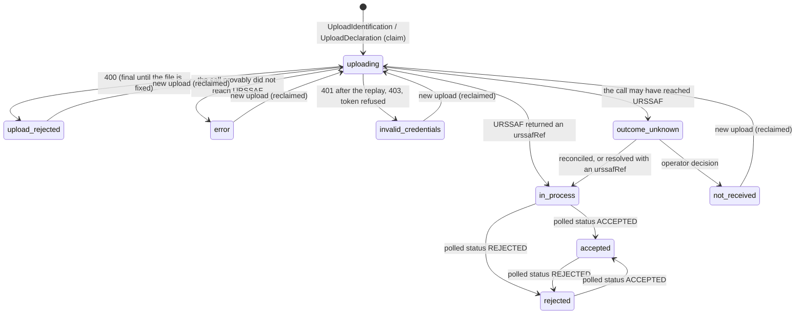

# Workflow

One aggregate carries the workflow: `Domain\Submission\Submission`, per tenant, one per uploaded file (identification,
declaration or regularisation). It has a local lifecycle (`Domain\Submission\SubmissionState`) and, once URSSAF knows
the file, the last status read at URSSAF: `status` (`FileStatus`: `IN_PROCESS`, `ACCEPTED`, `REJECTED`) and, for
declarations, the independent `paymentStatus` (`PaymentStatus`), both kept with their raw value
([ADR 0004](adr/0004-submission-lifecycle.md)). Every transition is explicit; an invalid one throws
`Domain\Exception\InvalidStateTransition`. The aggregate records domain events (`releaseEvents()`), which `UnitOfWork`
publishes after the transaction commits.

The file content is never stored ([ADR 0005](adr/0005-files.md)): there is no queue of files waiting to be sent, and an
upload is synchronous (the record is claimed, the file is sent, the outcome is recorded).

## Submission lifecycle

| State | Meaning | Reclaimable by a new upload | Occupies a declaration slot (ADR 0008) |
|---|---|---|---|
| `uploading` | claimed, the upload call is in flight | no | yes |
| `in_process` | URSSAF returned an `urssafRef`; its status is polled | no | yes |
| `accepted` | polled status `ACCEPTED` | no | no |
| `rejected` | polled status `REJECTED` (the global report details the reasons) | no | no |
| `upload_rejected` | the upload was refused (400): fix the file | yes | no |
| `error` | the call provably did not reach URSSAF | yes | no |
| `invalid_credentials` | URSSAF refused the tenant credentials | yes | no |
| `outcome_unknown` | the call may have reached URSSAF, no answer received | no | yes |
| `not_received` | an operator decided that an unknown upload never reached URSSAF | yes | no |

`accepted` and `rejected` may follow one another because the order of the polled statuses is not enforced (what
URSSAF reports is recorded). Any status other than `ACCEPTED` and `REJECTED` (still in process, unknown or missing)
keeps the current state; an unknown raw value is stored as is.

## Re-entry (idempotency)

An upload is identified by the tenant and the host external reference (unique together); the fingerprint is a SHA-256
of the kind, the declaration type, the file name and the SHA-256 of the content, computed by streaming the file once
before the upload ([ADR 0004](adr/0004-submission-lifecycle.md)).

| Existing record | Same fingerprint | Different fingerprint |
|---|---|---|
| none | created, uploaded | - |
| `uploading` | `not_claimed` (another process is sending it) | `SubmissionAlreadyRecorded` |
| `in_process`, `accepted`, `rejected`, `outcome_unknown` | replayed: the record is returned, nothing is sent | `SubmissionAlreadyRecorded` |
| `error`, `invalid_credentials`, `upload_rejected`, `not_received` | reclaimed (atomic claim, attempts + 1) and uploaded, until `WorkflowPolicy::maxUploadAttempts()` (default 5), then `exhausted` | `SubmissionAlreadyRecorded` |

The upload handlers return an `UploadReport` whose `outcome` is `uploaded`, `replayed`, `not_claimed`, `rejected` (with
the `ApiErrors`), `invalid_credentials`, `outcome_unknown` or `exhausted`. A retryable failure moves the record to
`error` and is rethrown as `RetryableUrssafFailure` (with the `Retry-After` delay when known).

## Polling

URSSAF processes the files asynchronously: an upload only answers an `urssafRef`. `SyncSubmissionStatuses` (per tenant,
with a `limit`; `SyncAllSubmissionStatuses` for every tenant) reads at URSSAF, least recently polled first:

- the submissions `in_process`;
- the declarations whose `paymentStatus` is not settled. A declaration is settled when it is `ACCEPTED` and `PROCESSED`
  (the "full flow complete" of the API reference section 3.2); every other combination may still change, including the
  `INTERLOCUTION` and `DECLARED` / `PROCESSING` round trips.

Identifications are not polled once `accepted` or `rejected`. A submission is not polled again before the interval of
its phase, nor after `maxPollingAge()` since its creation. These values are package choices, not URSSAF rules
(`Application\Policy\WorkflowPolicy`, configurable):

| Policy | Default | Bundle key |
|---|---|---|
| `statusPollInterval` (while `in_process`) | `PT10M` | `workflow.status_poll_interval` |
| `paymentPollInterval` (processed declaration, payment not settled) | `PT6H` | `workflow.payment_poll_interval` |
| `maxPollingAge` | `P1Y` | `workflow.max_polling_age` |
| `maxUploadAttempts` | 5 | `workflow.max_upload_attempts` |
| `staleUploadAfter` | `PT1H` | `workflow.stale_upload_after` |
| `manualReviewAfter` | `P1D` | `workflow.manual_review_after` |
| `reconciliationMaxPages` (pages of 500 items) | 1 | `workflow.reconciliation_max_pages` |
| concurrent declaration guard | on | `workflow.concurrent_declaration_guard` |
| `outboxRetention` | `P30D` | `outbox.retention` |
| default / maximum number of records of a batch | 100 / 1000 | `workflow.default_page_size` / `workflow.max_page_size` |

`RefreshSubmission` reads one submission on demand. The live queries (`GetIdentification`, `GetDeclaration`, the
searches, the downloads and the news feed) call URSSAF directly and never change the local records.

## Unknown outcome and reconciliation

The uploads have no idempotency key, so they are **never resent automatically** when the call may have reached URSSAF
([ADR 0003](adr/0003-unknown-upload-outcome.md)):

- Safe to retry: the token call, every read, and the uploads when the call provably did not reach URSSAF (429, a local
  rate-limit refusal, a token failure, the replay after a 401). The record goes `error`, then may be reclaimed.
- A transport error, any 5xx, or a 2xx answer that cannot be read (invalid JSON, missing or empty `urssafRef`) throws
  `OutcomeUnknown`: the record moves to `outcome_unknown`. A submission left `uploading` for at least `staleUploadAfter`
  (a process died between the claim and the answer) moves to `outcome_unknown` too.
- `ReconcileUnknownSubmissions` searches the matching operation (identifications, or declarations filtered by `type`),
  sorted `lastUpdateDate:DESC`, `size` 500, up to `reconciliationMaxPages` pages, and adopts the only result whose file
  name equals the uploaded name and whose `urssafRef` is not already known locally for the tenant: the submission
  moves to `in_process` with that reference and is then polled normally. That URSSAF echoes the uploaded `name`
  verbatim in the file name field is not published and is checked by the contract tests
  ([api-reference.md](api-reference.md) section 5).
- Zero or several candidates leave the submission `outcome_unknown`; past `manualReviewAfter` it is reported as needing
  a manual review (`TenantOverview::needingAttention()` of `GetWorkflowOverview`, `urssaf:pn:status`). An operator checks on the URSSAF
  side and records the result with `ResolveSubmissionOutcome` (`urssaf:pn:submission:resolve`): received (with its
  `urssafRef`) moves to `in_process`, not received moves to `not_received`, after which the host may upload the same
  file again.
- A refusal of the credentials puts the record in `invalid_credentials` and returns a report (no exception); after the
  credentials are fixed, uploading the same reference again reclaims it. There is no requeue command: the content is
  not stored, so the host re-enters.

The package never produces a duplicate submission by itself.

## Declaration guard

URSSAF accepts (`200`) a second file of a type already in process, then rejects it asynchronously: only one
`DECLARATION` and one `REGULARISATION` can be in process at a time ([ADR 0008](adr/0008-concurrent-declaration-guard.md)).
`UploadDeclaration` refuses locally, with an `InvariantViolation` `submission.declaration_in_process`, an upload of a
type while another submission of the same tenant and type is `uploading`, `in_process` or `outcome_unknown`. The check
runs inside the claim transaction; the Symfony bridge also serialises uploads per tenant and type with a non-blocking
lock. Opt-out: `WorkflowPolicy::withoutConcurrentDeclarationGuard()` (bundle `workflow.concurrent_declaration_guard:
false`). Identifications are not guarded ("should" is not a rule).

## Events, outbox and scheduling

- Domain events are published by `UnitOfWork` after the package transaction commits. A listener that throws does not
  undo the work. For anything that must not be lost, enable the outbox: public integration events (`urssaf.pn.*`) are
  written in the transaction of the state change and relayed at least once
  ([integration-events.md](integration-events.md), [ADR 0010](adr/0010-integration-events.md)).
- No scheduler runs on its own: call `SyncAllSubmissionStatuses` (or `SyncSubmissionStatuses` per tenant),
  `ReconcileUnknownSubmissions` and `RelayOutbox` from a cron job ([standalone.md](standalone.md)), the console commands
  `urssaf:pn:submissions:sync`, `urssaf:pn:submissions:reconcile` and `urssaf:pn:outbox:relay`, or the Symfony Scheduler
  schedule `urssaf_pn` ([symfony.md](symfony.md#scheduler)).
- Messenger: `SyncTenantSubmissionsMessage` and `ReconcileTenantSubmissionsMessage` carry the tenant id only and are
  safe to retry. There is no upload message. `OutcomeUnknown` and every non-retryable package exception are
  unrecoverable; `RetryableException` is recoverable with its delay ([symfony.md](symfony.md#messenger)).
- Two runs of the same use case must not overlap: the bundle takes a non-blocking lock per tenant (and declaration type
  for uploads); without it, the atomic claims keep them safe but wasteful.
